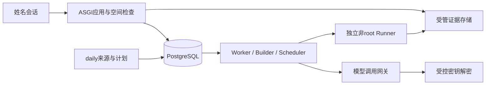

# 多用户、个人模型配置与统一数据平台

状态：2026-10-27，首版已实现。实际运行说明与当前边界见 [PLATFORM_USAGE.md](PLATFORM_USAGE.md)。本文保留完整目标架构；未在使用说明列出的 RLS、独立容器 Runner、真实模型网关、SDK Builder 与 latest 门禁仍为后续设计，不能视为已实现。

## 1. 产品边界

- 用户输入名字进入同一持久个人工作区，无密码。名字相同则进入同一工作区；同名用户需使用可区分的登录名。显示名可修改，内部user_id/workspace_id保持稳定。
- 姓名经过NFC、首尾空白、大小写规则、长度与控制字符校验；canonical_name唯一。姓名不作为路径、系统账户、授权角色、主键或SQL拼接内容。
- name-only只在可信内网提供协作式归属，不是可靠身份验证。不可承诺“别人无法冒名查看我的数据或调用我的API额度”。即使Key永不读回，冒名者也可能通过任务使用它。未来需要真正私有密钥时，可替换身份适配器接入SSO/Passkey；不强制改变当前无密码需求。
- 普通名字admin/root不获得管理能力。系统操作由部署CLI或独立受控管理身份执行。公共daily使用system workspace/service principal，不归到某个普通用户。

## 2. 技术选择与职责

正式共享服务器：ASGI/FastAPI应用服务 + PostgreSQL + SQLAlchemy/Alembic + 独立Worker/Builder；本机受管目录保存大文件，后续通过BlobStore切换对象存储。SQLite保留单进程本地开发用途；不能以SQLite测试通过代替PostgreSQL租约/RLS/并发验收。

数据库是任务、所有权、快照、查询与状态的事实源；文件是有校验的证据对象，不再扫描整个目录构建列表。首版可直接用数据库持久队列，暂不要求Redis/Celery/Elasticsearch。业务服务不绑定HTTP或ORM，CLI与HTTP复用Repository接口。



sudo用于安装、systemd启停和设备初始化，普通API/Builder/Runner分开权限运行。Runner不能挂载数据库、密钥目录、其他用户工作区、全部历史报告或容器管理socket；创建目录不是完整的进程/设备隔离。

## 3. 用户、会话与工作区

| 表 | 主要字段与约束 |
|---|---|
| users | id UUID、login_name、canonical_name UNIQUE、display_name、state、created_at |
| workspaces | id UUID、kind(personal/system)、owner_user_id；personal owner唯一 |
| sessions | id、user_id、token_hash、expires_at、revoked_at；不存原始会话token |
| workspace_memberships | workspace_id、principal_id、role；首版个人owner+公共只读，预留团队空间 |
| resource_grants | workspace/resource/published scope、subject、read/manage；分享必须显式建立 |
| audit_events | actor、workspace_id、action、object_id、时间、请求ID与脱敏差异 |

POST /api/sessions接收name，规范化后事务性upsert用户和个人空间，创建随机会话Cookie；GET /api/me返回用户/工作区/模式；DELETE /api/session撤销。HTTPS生产使用HttpOnly/Secure/SameSite Cookie，状态变更校验Origin与CSRF。每次请求先构造可信ActorContext，用户请求体不允许自选owner_id或workspace_id。

私有表带workspace_id；所有读取、取消、复测、事件、报告、附件、模型测试及下载都先做对象归属检查。不是前端过滤，也不只在列表API加WHERE。跨用户对象默认404。后台任务记录发起主体和明确授权上下文。

PostgreSQL RLS作为附加防漏层，应用仍保留访问策略。运行账户不能是表owner/superuser/BYPASSRLS；按需FORCE RLS。连接池每个事务SET LOCAL空间上下文，退出事务自动清除，不能把上一个请求空间泄漏给下一个请求。RLS不修复姓名冒用，也不限制持有全部解密权限的宿主管理员。

## 4. 个人AI配置

| 表 | 含义 |
|---|---|
| ai_profiles | id、workspace_id、name、default flag、enabled、current_revision_id |
| ai_profile_revisions | id、workspace_id、profile_id、provider、base_url、api_flavor、model、generation参数、timeout/retry、secret_ref、created_at；不可变 |
| secret_versions | id、workspace_id、secret_ref、ciphertext、nonce、key_id、algorithm、state；原始Key不读回 |
| ai_call_records | task/experiment、workspace、profile_revision、actual_secret_version、provider/model、usage、耗时、状态、request_id、脱敏证据引用 |
| usage_reservations | workspace/task、调用/Token预算预留、结算状态；失败未知usage也保留记录 |

网页“Agent → 模型配置”：配置名称、Provider、Base URL、模型ID、Key输入、超时、最大输出、数据发送策略、默认配置；提供保存、连通性测试、更新Key、停用。GET仅返回has_key与脱敏指示，不返回密文/明文，导出不含secret。测试连接是一项显式的可能计费操作，默认不发送case源码或历史日志。

Key使用成熟库的认证加密（例如AES-GCM），不自造算法；主密钥不放数据库、代码、证据包或任务环境。生产可由systemd credential/受限文件或secret manager提供给模型网关。记录key_id以支持主密钥轮换；备份必须同时有可恢复的密钥保管方案，但密钥与DB备份分开访问。

配置变更产生revision，不修改旧任务的模型/端点参数。任务锁定profile_revision与secret_ref；正常Key轮换允许网关解析该引用的当前有效secret version，每次实际使用哪个version写入call record。禁止自动回退到已撤销Key或其他用户的默认模型；无有效Key则needs_configuration，既有实验与报告仍可读。若改变provider/model/base_url，必须创建新配置revision并作为新的调查分支/显式变更记录。

允许内网模型地址，但server管理员登记可访问端点/网段与端口；用户配置在许可范围内选取，防止借模型Base URL访问数据库、云metadata或管理接口。跳转及DNS解析后的实际地址同样按策略检查；内网不是一律禁止。密钥不交给pytest Runner；仅模型网关在请求时解密、调用并脱敏记录。

## 5. 统一业务数据模型

### 公共制品与daily

| 表 | 主要含义 |
|---|---|
| artifact_sources | 登记的SDK/whl/so来源、团队、轨道、平台、凭据引用、可用状态 |
| artifacts | 内容对象、SHA256、大小、媒体类型、存储key；相同内容可去重 |
| sdk_builds | source/channel/platform、build_id、build_date、published_at、manifest_digest、可获取状态 |
| sdk_components | sdk_build_id、component_id、version、artifact_id、ABI/依赖闭包、可信仓库/commit映射 |
| environment_revisions | 完整制品组合、Python/基础镜像、配方digest、门禁范围；不可变 |
| environment_aliases | public latest/recommended或个人别名，指向固定revision |
| daily_definitions | 来源、计划、时区、case suite、门禁、resource_class；系统主体所有 |
| daily_batches | definition、业务日期、计划/实际时间、冻结构建与环境、摘要、状态 |
| daily_batch_tasks | daily batch与统一测试/构建任务的关联 |

SDK daily入库与daily测试分开：发现新制品不代表测试通过。一日多构建分别登记；业务日期显式按Asia/Shanghai，实际时间用UTC timestamptz。latest只在门禁满足后原子指向新revision，失败构建不覆盖旧latest；回归任务开始后锁定本次latest。相同版本但内容不同产生新制品/构建revision。

公共可发布制品属于system空间；个人组合配方属于个人空间，引用已发布公共制品。用户不需要复制整套LLVM/Torch制品。私有上传内容仍按私有资源访问，物理去重不等于允许跨用户下载或泄漏其是否存在。

### case、任务、实验与结果

| 表 | 主要含义 |
|---|---|
| projects / project_revisions | 登记项目与不可变源码快照；项目归属/分享独立管理 |
| case_definitions / case_configurations | 文件、类/函数、逻辑ID、nodeid、配置参数与版本、算子、markers |
| collections / collection_items | 固定环境/源码下的实际收集结果；参数实例选择依据 |
| environment_recipes | 用户命名组合，引用不可变环境revision |
| tasks | id、workspace、kind(pytest/regression/profiling/build/daily)、状态、预算、幂等键、revision与租约 |
| regression_tasks | task_id、baseline/target锁、判据、搜索精度、当前范围、结论code及范围 |
| experiments | task_id、workspace_id、kind/候选、环境/源码快照、repeat、predicate_revision |
| execution_runs | 一次实际子进程/runner执行，含退出、信号、资源、Python/设备与日志索引 |
| case_results | run与具体配置的最终唯一结果、起止/耗时/worker、failure_fingerprint |
| case_stage_results | setup/call/teardown原始结果与阶段证据，不与最终配置统计混算 |
| agent_decisions / claims | 模型动作、候选与证据引用、结论审核结果；不能覆盖原始结果 |
| task_events / checkpoints | 有序增量事件、可恢复状态与schema_version |
| report_artifacts / blob_refs | 报告、stdout/stderr、trace、附件与证据包的索引/哈希/可用性 |
| devices / resource_leases | 执行资源、健康、任务持有、过期、心跳与fencing generation |

主键UUID；同一任务的子表同时保存workspace_id，使用组合外键约束私有对象不能串空间。例如tasks UNIQUE(workspace_id,id)，experiments FOREIGN KEY(workspace_id,task_id) REFERENCES tasks(workspace_id,id)。个人模型revision也使用同空间组合外键。公共environment/artifact引用按发布状态和resource_grants校验，不能机械要求其workspace等于个人任务workspace。

tasks不是装下所有结果的巨型JSON；经常查询的字段独立成列，扩展参数/context/receipt摘要用版本化JSONB。stdout大正文、二进制trace、HTML不重复灌进结果表。历史源码/环境/模型revision只读，复测创建新task/run并保存rerun_of/derived_from/compare_to；改变参数/源码或环境不是完全同条件复测。

case_key可采用项目稳定ID+规范化nodeid/参数digest的版本化指纹；同时保存源码revision和显式case_id，不能把同名改写case视为语义相同。失败fingerprint由固定判据和结构化异常生成，算法版本入库；不同指纹不自动算同一回归。

## 6. 存储布局与文件一致性

```text
/var/lib/triton-dev/
  blobs/sha256/<prefix>/<digest>       # immutable evidence/artifact objects
  users/<user_id>/                    # only user-local nonshared files
  workspaces/<workspace_id>/
    tasks/<task_id>/attempts/<attempt_id>/  # ephemeral runner workspace
  staging/                           # atomic upload/materialization staging
```

数据库与文件不是一个原子事务。先写staging并校验/hash，原子发布blob，再提交READY索引；中断时可能出现无引用blob，由延迟GC回收。索引中若文件丢失标missing并告警，不返回空文件冒充报告。对象下载使用artifact ID，通过API鉴权后流式返回，不暴露任意路径或直接公开整个目录。

清理根据引用、保留策略与soft-delete执行，不能删除活动任务/复测锁定的环境或证据。保留参数分别管理可索引结果、原始大日志、制品和备份；具体时长由管理员配置。备份含数据库、引用blob清单及独立密钥保管；定期做恢复验收，而不是只验证备份命令成功。

## 7. 调度、事务与恢复

提交时一次事务完成所有权/资源权限检查、固定源码/环境/模型revision、创建task、记录幂等键与queued事件。幂等唯一键按(workspace_id,kind,idempotency_key)，相同key不同request_digest返回409。不要commit前就启动pytest。

Worker用短事务领取queued记录并写lease，随后释放事务执行；可用FOR UPDATE SKIP LOCKED。心跳延长lease，所有结果写入携带attempt/fencing generation做CAS。不要持有DB行锁等待case或模型请求。状态更新、事件和checkpoint在同一事务提交。

恢复先核对已有run/result和外部资源状态。租约过期不直接认为旧设备进程已停止；疑似仍执行标reconcile_required，清理/确认后再允许重试。取消终止完整进程组/容器，再释放设备；失败则unhealthy。数据库租约与物理设备排他是两个层次。

API与Worker不再使用各自内存ThreadPool作为全局事实源；保留内部线程作为执行机制可以，但排队/归属/预算均在DB。模型预算在发送前预留，未知usage/网络超时不能当成0消耗。费用按可信价格版本计算，缺usage或价格显示unknown，不能伪造精确账单。

## 8. 查询与统计设计

默认我的空间，公共daily入口单独列出；显式共享报告通过grants开放。全局查询服务接收ActorContext与结构化过滤，不允许前端传SQL。

重点查询：

1. 我的回归调查：时间、状态、case/算子、基线/坏SDK、组件结论、模型。
2. daily日历：轨道、平台、构建/制品可用状态、门禁、通过/失败/基础设施异常。
3. 同一case历史：固定配置键、源码revision、环境指纹、故障签名、首次/最近观测。
4. 包版本影响：component+artifact hash关联的失败配置/实验，避免只按版本字符串比较。
5. 用户使用：任务数、运行工时、模型调用/Token/可核实费用、存储大小。
6. 同一调查的SDK搜索与组件矩阵：直接按task/experiment查询，不扫描各目录或模型长日志。

建议索引：

- tasks(workspace_id,created_at DESC,id DESC)、tasks(workspace_id,state,created_at DESC,id DESC)
- experiments(workspace_id,task_id,created_at,id)
- case_results(workspace_id,case_key,finished_at DESC,id DESC)
- case_results(workspace_id,failure_fingerprint,finished_at DESC)
- sdk_builds(source_id,channel,platform,build_date DESC,build_order DESC,id DESC)
- ai_call_records(workspace_id,created_at DESC)、task_events(task_id,seq) UNIQUE

使用(created_at,id)游标分页；候选索引按真实查询EXPLAIN验收，不为所有组合机械建索引。初版结构化精确/前缀过滤与PostgreSQL查询足够；中文全文和超大日志检索有明确需求后再选方案。JSONB仅对稳定高频条件增加有针对性的索引。

配置计数基于case_results最终行去重，阶段失败不重复计算；PASS/FAIL/CRASH/SKIP/XFAIL/XPASS/UNKNOWN独立口径。并行批次墙钟与累计阶段工时分开。汇总表/物化视图是可重建派生数据，记录统计版本，不能成为唯一证据源。

## 9. API与网页调整

拟议新增：

```text
POST /api/sessions {name}
GET /api/me
DELETE /api/session
GET/POST /api/me/ai-profiles
PATCH /api/me/ai-profiles/:id
PUT /api/me/ai-profiles/:id/secret
POST /api/me/ai-profiles/:id/test
GET /api/me/usage
GET /api/tasks?kind=regression&state=...&cursor=...&limit=50
GET /api/case-results?case_key=...&outcome=FAIL&...
GET /api/sdk-builds?channel=...&platform=...&from=...&to=...
GET /api/daily-batches?from=...&to=...
GET /api/tasks/:id/events?after=...
GET /api/artifacts/:id/download
```

现有regression任务API可保留兼容路由，底层统一tasks/Repository；新增会话鉴权与归属，不仅套一个登录弹窗。浏览器不传workspace来切换身份，未来团队空间切换需服务端检查membership。旧Bearer本地开发入口明确区分，不能同一路由收到任意Bearer就绕开新会话策略。

前端：姓名进入/切换用户/退出；右上角当前用户；“我的任务/我的报告/我的环境”；Agent分组新增可用模型配置；daily公共数据中心；任务提交选择个人profile；全局查询页支持结构化筛选和可保存视图。退出清空缓存、令牌及SSE，查询cache key绑定user/workspace，迟到响应按session generation丢弃，不能把上个人的数据闪到下个人页面。

## 10. 代码与迁移

```text
triton_dev/platform/
  auth/             # name-only adapter, sessions, ActorContext
  access.py         # workspace/grant policy
  storage/          # repository ports, SQLAlchemy, BlobStore
  models/           # typed business entities
  migrations/       # Alembic revisions
  scheduling/       # claim/heartbeat/lease/reconcile
  ai/               # profile revisions, secret broker, call ledger
triton_dev/serve/app.py          # ASGI transport only
triton_dev/agent/regression/     # existing orchestration, inject repositories/executor
```

不要把所有改动塞入现有http.server handler。先抽Repository替换RunStore.list与RegressionService.list的目录扫描、JSON写状态和全量轮询；保留文件导出用于审计，而不是双主存储。SQLAlchemy统一模型、Alembic做可追溯迁移，发布前检查schema版本。

迁移步骤：

1. DB schema与Repository、BlobStore，建立public/system/legacy空间；同一套业务契约测试跑文件与数据库适配器。
2. 备份原目录，生成只读import manifest，按legacy_source+legacy_id+digest幂等导入任务、阶段、报告和回归证据；保留旧ID映射/版本。缺字段显式unknown，不能靠模型补全。
3. 历史无owner数据进入legacy/unassigned，由管理员显式分配或发布；不能归给第一个登录人。
4. 校验总量、最终case状态数、父子引用、artifact哈希和报告链接。切换期短暂停止写任务，最后增量导入并切换DB事实源；避免无补偿机制的文件/DB双写。
5. 姓名会话+个人空间+分页查询；再接个人模型配置与密钥；再替换调度租约；再接daily采集/调度与查询看板。演示回放保持纯浏览器数据，绝不导入真实结果表。
6. 在PostgreSQL实际验收跨用户对象拒绝、RLS、并发认领、崩溃恢复与备份恢复；SQLite/Mock通过不替代这些验收。

## 11. 分期验收

- P0 数据底座：迁移脚本、任务/结果/证据索引、列表分页与过滤；旧数据可追溯。
- P1 多用户：姓名会话、同名复用、私有工作区、对象级访问检查、跨用户迟到响应隔离。
- P2 AI配置：个人profile+revision、加密Key、不可读回、连通性测试、额度账本、轮换/停用；真实provider需独立授权与验收。
- P3 执行管理：DB持久队列、公平调度与全局并发、设备lease、取消/恢复、原case复测和引用保护。
- P4 daily与数据中心：幂等采集、候选门禁、latest原子发布、日期/组件/case历史与趋势。

关键负面用例：用户A通过ID/附件/事件/复测入口访问B；请求体篡改owner；同名冒用的既定行为；Key出现在导出或Runner环境；profile改动污染旧任务；双worker领取同task；API/worker掉线重复启动实验；DB有记录但blob丢失；daily重复导入/同版本不同哈希；迁移重跑重复计数；恢复时误把UNKNOWN当PASS。

## 官方依据

- PostgreSQL行级安全：https://www.postgresql.org/docs/current/ddl-rowsecurity.html （owner/superuser/BYPASSRLS的例外必须处理）
- PostgreSQL SELECT/锁：https://www.postgresql.org/docs/current/sql-select.html （SKIP LOCKED适合队列领取，不能替代资源清理与证据一致性）
- SQLite适用范围：https://www.sqlite.org/whentouse.html （本地存储与共享数据库的取舍）
- Alembic迁移：https://alembic.sqlalchemy.org/en/latest/tutorial.html

以上官方资料查阅于2026-10-27。实现前按目标服务器、PostgreSQL和Python版本锁定依赖并验证。
