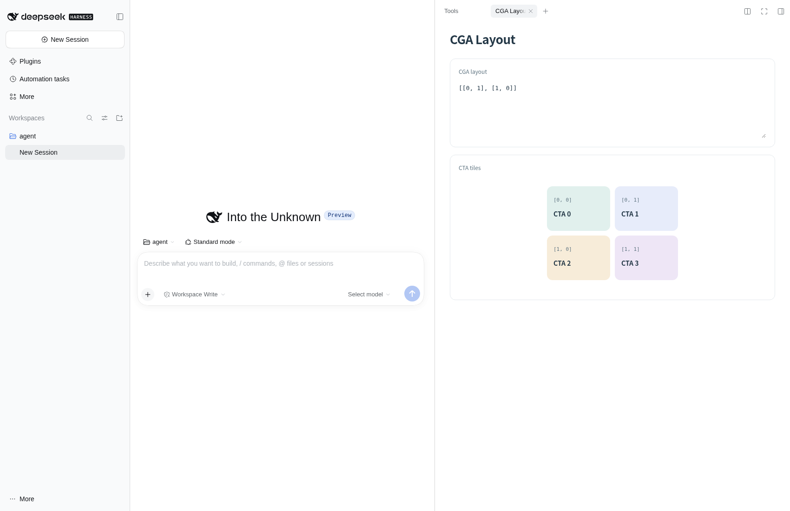

# Triton Developer Workbench on DeepSeek Harness

状态：外网 demo 集成实现；真实模型、设备、SDK 和内网部署需要独立验收。
分支：`triton-dev-harness`。
已验证运行版本：官方 npm `@deepseek-ai/dsh@0.2.2-rc.1`；上游接口审阅基线：deepseek-ai/deepseek-harness `ca33fd6843b205e279c7ccb6cb73a472c78f5760`（0.2.2-rc.4 源码）。不要把 npm 中不同版本的拆分包混装为该版本。

## 1. 产品与依赖边界

DeepSeek Harness 是宿主，保留其原有对话、插件管理、模型设置、权限机制和工具扩展。triton-dev 是领域插件，不 fork AgentLoop，不修改默认 profile，不替换原有 tools/webServer/slots/sidebar 服务，不占用根路由或 `/api`。安装是增量 profile patch，卸载撤销插件注册。

当前一个插件包中包含三个相互独立的职责，未来可拆包而不改变领域服务：

1. `harness/src/index.js`：Host 工具适配与认证 `/triton` 路由。
2. `harness/src/client.jsx`：Client 标签与工具结果卡片。
3. `triton_dev/harness`：Python CLI 能力发现与受控 JSON worker。

Python 承担 SDK/测试/实验/证据。Harness 承担模型、上下文和 AI 编排。现有 React 业务页面通过独立 iframe 保留浅色青绿 UI、Canvas、Monaco 和报告；Harness 提供统一导航和标签，嵌入页不渲染原全局侧栏、品牌头部及连接顶栏；这样 React 19 页面与 Harness React 18 插件不共用组件运行时。iframe 同源，不允许任意第三方 URL。默认入口仍是 Harness 对话；右侧工作台可按 Harness 自带布局展开。

## 2. AI 与页面使用同一能力

工具名分为 `triton_cli_*`、`triton_api_*`、`triton_layout_*` 和 `triton_open_page`。CLI 参数从 argparse/describe 派生；HTTP 端点从实际 ASGI 路由定义派生，方法和路径由目录固定，模型不能指定任意 URL。路径参数必须是单段；服务继续验证业务字段、项目白名单、预算和所有权。`--sdk-root` 与 `--cache-root` 由部署方固定，模型不能覆盖。

HTTP body 使用领域原有 JSON，工具说明列出 handler 使用的字段；具体配置见原模块文档。应优先使用这些结构化工具，而不是让 AI 拼接 shell。交互终端和任意 argv 命令仍有工具入口，但返回 `REGISTERED_JOB_REQUIRED`；使用管理员登记项目的 collect/run/rerun 等等价服务完成执行。此限制不是功能删除：原 CLI 保留。

CGA 与 Blocked AI 工具直接导入 frontend 原有纯 JS 计算函数，避免 Python/JS 两份算法漂移。source/shape 随 `triton_view` 进入原页面的输入框。布局结果只是逻辑映射，不能解释为执行了 kernel。

## 3. 功能保留与接入矩阵

| 领域 | 原页面 | AI 接入 | 当前真实范围 |
|---|---|---|---|
| SDK、环境、组合、下载与验证 | env | CLI 全目录；SDK 元数据 API | 离线合成 SDK 可验，真实原生 ABI 未验 |
| case 收集、参数实例、xdist、复测、取消 | runs | jobs/tasks/pytest API | 登记项目真实 CPU pytest |
| 统计、报告、日志、附件、导出 | reports/data/runs | tasks/events/artifacts/case-results/data API，CLI runs | 原证据及来源标记保留 |
| Profiling | profiling | catalog/reports/trace/html API | 原 mock 板卡；不能声称 CPU 测试产生真实设备 profiling |
| 回归定位、实验、报告、恢复 | regression/diagnosis | regression API 与 diagnose CLI | 原 mock SDK/模型 + CPU 实验 |
| Daily 计划、批次、质量日历、日志 | daily | daily/v1 全端点 | 原 mock 环境 + CPU pytest |
| Kernel Lab、trace 导入、编译任务 | kernel | ir API/CLI | 导入可用，编译必须登记真实隔离执行器 |
| CGA、Blocked | tools-cga/tools-blocked | 同源算法工具 | 纯逻辑计算 |
| 个人模型配置、用量 | models/settings | me/ai-profiles/usage API | 原保存功能保留；Agent 实际模型由 Harness 管理 |
| 页面导航 | 全部保留 | triton_open_page + 工具结果元数据 | 当前对话内标签自动展示与手动重开 |

环境/诊断浏览器演示继续显式标注演示。不能把 CLI 查到的真实环境与浏览器预设组合合并成虚构状态；后续内网版应提供环境 revision 的统一领域 API 再替换该页面数据源。现有离线演示可以独立运行。

## 4. 工作流与执行事实

推荐模型步骤：列 jobs → POST tasks 收集登记 pytest 项目 → GET tasks/{id} 至终态 → 从 collection 中选 nodeids → POST pytest/runs → 查询/取消/复测 → 读取 evidence → 可选 Profiling catalog/reports → 打开相应页面。

长任务提交立即返回 id；不可把一次 LLM 连接当成任务生命周期。结束对话不删除运行，重连用 id 读取。首次失败与复测分别保存；Harness session event 保存 AI 输入/工具调用，Triton task store 保存执行事实，通过 task_id 关联。不同系统的日志不互相覆盖。

`triton_view` 是 `{page, selection, issued_at}`，只接受固定页面，selection 是数据，不是脚本。Client 只为本插件注册的工具渲染卡片；收到本次 Client 启动后的工具结果才自动打开，历史回放只提供手动“在工作台查看”。支持 task/report/batch id 定位以及 layout 输入。CLI 类结果保存在对话的完整结果卡片；浏览器演示页面不会伪造对应执行。

## 5. 身份与权限

`/triton` 所有路由要求 Harness 原有 Web admission，绝不注册 anonymous 或修改原插件策略。Host 代理向 loopback Triton 服务发请求，cookie/CSRF 留在 Host，不向模型或浏览器返回后端凭据。Harness session 映射到独立 name-only demo workspace，AI 与同会话 iframe 使用相同工作区。

这是单个受信 Harness owner 的外网 demo 映射，不是生产多租户授权。name-only 身份本来不证明真实身份；不能直接公开为多人内网服务。内网迁移必须把代理的 id 映射改为经认证的 principal/workspace，并在每次读取/写入检查当前 peer 的会话访问权，禁止仅凭客户端传入 session id 访问。浏览器个人模型配置与 Harness provider 配置保持各自含义，不能自动复制密钥。

Host 配置 `enableWrites:false` 可关闭非只读 CLI 和所有非 GET API 工具。注意工具已注册不等于获得 OS 沙箱：内网需要 Runner 的独立进程/容器、文件根目录、设备租约和网络权限；自定义工具不会自动继承内建 shell 工具的全部安全语义。当前输入、权限与错误均不得伪装执行成功。

## 6. 内外网差异的迁移方法

保持稳定：工具 ID、输入结构、结果 envelope、task_id/collection/nodeid、取消语义、证据哈希、页面路由。差异落在 provider/adapter 和部署配置，避免在 JSX 或 AI prompt 中加入 `if internal` 分支。

| 差异 | 替换位置 | 验收标准 |
|---|---|---|
| 内网模型网关 | Harness 模型 provider 与部署凭据 | 流式响应、工具调用、断线恢复、脱敏；不得沿用 mock 通过记录 |
| SDK/JFrog、认证和缓存 | env 下载/发现 adapter；固定 SDK/cache roots | TLS/校验和、完整性、权限、断点错误；不修改预期哈希绕过校验 |
| 编译器、板卡、Profiling | compiler registry、Runner、ProfileStore 对应 adapter | 单次真实用例、环境 revision、设备租约、取消清理、时钟/事件来源 |
| 登录和空间隔离 | Harness peer → Triton principal 映射 | 两个用户交叉读取/修改/下载均拒绝；SSO 过期撤销 |
| PostgreSQL、对象存储、日志 | platform Database/Repository/blob adapter | migration、重启恢复、幂等、备份恢复、证据校验 |
| 内网 npm/PyPI 与离线镜像 | 安装脚本、固定依赖与上游 commit | 完整镜像/校验、无公网访问安装和启动 |
| 页面展示字段差异 | 保留页面组件；纯数据 mapper/版本化 DTO | 旧记录只读兼容、未知字段显式未知、无 mock 混入真实报告 |

迁移顺序：

1. 固定 Harness commit 和插件版本，保留外网合成测试作为契约测试。
2. 列出目标内网能力，逐项声明 available/mock/not_checked/unsupported；未接入工具应明确错误。
3. 先接身份和存储，再登记一个 SDK/pytest 项目/设备适配器；不一次迁移全部板卡。
4. 执行同一 collect → run → evidence → view 闭环，再做真实 profiling；保留两类结果来源。
5. 验证取消、进程中断、任务恢复、重复提交、越权访问、日志脱敏和证据下载。
6. 用内网镜像做断网安装与重启验收；保留数据库和证据备份，切换失败可回滚插件/profile，不能删除上游插件。

模型不应直接编写设备命令；新增设备能力先定义服务接口、结果证据和白名单执行器，再开放 AI 工具。外网 demo 的策略只能迁移为参考，不作为真实硬件正确性依据。

## 7. 兼容与升级

仅增量加载插件，不维护 Harness fork。上游升级时先用新版本做插件加载、原有插件工具共存、slots、工具 schema、会话恢复、API 代理和工作台 build 测试，再更新基线。CLI/HTTP 路由增加会进入工具目录；必须同时增加领域参数文档和测试。保留旧版本 task 读取，升级不得改写历史证据。

源码集成与测试命令见 `harness/README.md`。实际验证结果和未验证项应以当前运行记录为准；读过上游接口或通过适配器测试不等于完整 Harness 页面或真实模型已经验收。

## 集成界面实测

官方 Harness 0.2.2-rc.1 原有面板入口与 Triton 各模块的原生标签共存，浏览器无脚本错误。嵌入业务页面没有第二套全局导航；原独立应用外壳仅用于独立运行。截图展示独立 CGA Layout 标签；布局计算与真实 kernel 执行保持区分。

## 统一导航约定

每个领域模块拥有稳定的 Harness tab kind（例如 `triton-profiling`、`triton-runs`、`triton-tools-cga`）与独立标题。手动入口、页面内跨模块操作与 AI 的 `triton_view` 使用同一模块表解析目标。旧 `triton` 标签保持只读兼容入口，不再贡献完整应用菜单。工具连接设置和 Triton 历史模型配置保留为需要时打开的业务页，不重复添加通用设置导航。

`embedded=1` 与 Harness session 同时存在才启用内容模式。嵌入页的跨模块导航通过限定同源的 postMessage 交给宿主；宿主验证 origin、iframe source 和固定页面集合。独立浏览器运行继续使用原导航。不要在业务页加入新的全局导航或改变 Harness 自带插件入口。
