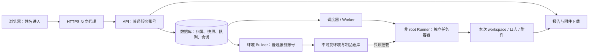

# 单服务器多人 pytest 平台设计

状态：目标架构与迁移方案，尚未实现生产部署。现有 loopback/Bearer 服务继续作为本地开发入口。本文不表示已具备姓名会话、多用户隔离、环境构建服务或容器执行能力。

## 已确认的产品要求

- 一台 Linux 服务器集中部署，由管理员通过 sudo 安装、启动和维护。
- 用户填写姓名即可进入工作台，不需要密码。
- 平台维护最新可用的 Triton 环境，用户可从已登记制品创建自己的组合。
- 用户选择指定 case / 参数实例，排队运行，查看日志、报告与复测对照。
- 已提交任务固定依赖和源码；平台更新 latest 不改变旧任务。

## 姓名与权限

采用 `name-only` 内网协作模式。姓名是任务归属标签，不是经过认证的真实身份。任何人填写相同姓名，都能进入相同工作区；“我的环境/我的报告”是整理与筛选功能，不提供抵御冒名的隐私保证。前端入口应注明“姓名用于任务归属，无需密码”，不称为已验证账号。

- `POST /api/sessions` 接收 display_name，服务端规范化、查找/创建内部随机 user_id，再创建随机会话。
- 姓名做 Unicode NFC、去首尾空格、长度1..64与控制字符检查；保存独立 canonical_name。姓名不用于磁盘路径、系统用户名或命令字符串。
- 同名明确复用同一命名空间，不静默创建两个无法区分的同名账号。
- 浏览器使用服务端会话 cookie；生产 HTTPS 下设置 Secure、HttpOnly、SameSite，配合来源和 CSRF 检查、失效和退出。会话防止每次请求自由传 owner_id，但不能弥补姓名本身可冒用。
- 网页填写 admin/root/管理员不会获得管理能力。初版公共网页只提供普通成员能力；环境发布、全局资源和制品源维护由服务器本地管理 CLI 或独立受控管理入口完成。
- 不把文件目录权限、设备白名单或硬配额建立在可随意改填的姓名上。全局并发、磁盘、超时和设备约束由执行端强制实施；按姓名的额度只作协作限流，不能作为可靠防滥用身份限制。
- 不将平台会话、制品仓库凭据、数据库凭据传给测试进程。报告默认面向可信内网协作；需要真正的私有数据/权限时，替换身份适配器接入可验证登录。

## 部署结构

**sudo 用来管理服务，pytest 实际进程以非 root 身份运行。** 推荐 systemd 管理 API、Builder、Worker，分别用服务账号与各自可写目录；管理员通过 sudo systemctl 启停。Python 包安装、SDK import、case collection 也会执行代码，同样不在 root 进程中完成。

- Web/API：负责会话、参数校验、查询、入队和下载，不直接调用 pytest。
- Builder：持有只读制品下载凭据，构建隔离环境与门禁检查；与 Runner 分离。
- Worker：从持久队列领取任务，控制资源和生命周期，不将 Web 请求翻译成自由 shell。
- Runner：默认考虑 rootless OCI 容器；独立可写 workspace，只挂载本次源码、只读环境及必要设备，不能挂载服务数据库、全部历史报告、宿主根目录或容器管理 socket。
- 真正需要特权的设备初始化/权限配置由管理员或窄接口 helper 执行，只接受服务器登记的设备 ID 和动作，不接受用户路径、argv 或任意 shell。
- 原生设备能否在 rootless 容器下使用，需要对目标驱动与设备节点单独验证；不满足时显式标记该 runner 不可用，保留受限专用 worker 适配路线。

部署技术建议：HTTPS反向代理 + FastAPI/ASGI API + PostgreSQL + 独立 Worker/Builder，报告文件初期存本机受管目录。初版可用数据库队列和租约，不必同时引入 Redis/Celery。API 进程扩容与任务 worker 数量分别配置，不能把每个 HTTP 进程各自的内存队列当全局调度。

现有 http.server 保留本地调试用途；正式服务需要替换其传输与会话层，复用已有 cases/env/execution/reporting 业务逻辑。

## 最新环境与个人组合

用户拥有的是组合配方，不是可随意 pip install 的共享活动 venv。维护三类对象：

| 对象 | 内容 | 可变性 |
| --- | --- | --- |
| Artifact | whl/so/SDK 的来源、版本、哈希、ABI/平台、依赖和可选已证实 commit | 不可变；相同版本内容改变须产生新对象 |
| EnvironmentRevision | 完整组件清单、解释器/基础镜像、安装配方版本、文件哈希、验证范围 | 发布后不可变，内容指纹作缓存键 |
| EnvironmentAlias / Recipe | latest、recommended、用户显示名称，以及选取的制品 ID | 别名可更新，运行时必须解析到固定 revision |

更新过程：发现制品 → 下载校验 → 新建候选环境 → 安装/导入/编译或设备 smoke → 记录实际门禁结果 → 发布 ready revision → 原子更新 latest 别名。失败停留在候选状态，保留原因，原 latest 继续可用。latest 在这里指“最新满足已配置门禁的环境”；界面同时展示门禁覆盖范围，不能将仅 import 通过显示成设备验证通过。

依赖组合示例：基础 SDK-A + Triton wheel-B + Torch wheel-C。后端用具体 artifact ID 解析；同一内容指纹只构建一次，多用户等待同一构建，成功后只读复用。用户配方名可不同，实际构建去重。

原生 LLVM/cmodel/firmware 等只开放已经确认可独立替换的边界；ABI、文件归属或组合规则未知时返回不支持，不通过任意 lib 路径拼接声称混用成功。

每次提交固定环境 revision、源码 snapshot、参数 schema 版本、具体参数值、seed、runner 配方和设备需求。队列中等待的任务也不能在开跑时重新解析 latest。旧 revision 有引用即不能清理；名称更新不会覆盖其 venv 或镜像。

## case 与资源

公共 case 项目由维护者发布具体 Git commit/源码快照。用户选择已经收集的 nodeid，参数编辑依据服务器登记的 schema，不开放自由 pytest argv、任意 Python 表达式或任意文件路径。第一阶段维持“只选已收集参数实例”，参数覆盖作为后续独立功能。

- CPU、cmodel、真实设备任务用不同 resource_class 和 runner 配方。
- CPU可按核数/内存预算并发；设备任务领取真实设备租约，默认一个设备一个活动任务。
- 租约含 run_id、worker_id、过期时间、心跳及 fencing generation；失联后不能仅凭租约过期就把可能仍被旧进程使用的设备分配出去。
- 取消须终止完整任务容器/受管进程组，再确认资源释放。清理/健康探测失败将设备置为 unhealthy，阻止后续任务并显示原因。
- Runner控制CPU、内存、进程数、运行时间、输出和磁盘预算；单用户限额不替代全局预算。
- case/session 两种隔离继续保留；容器提供任务级边界，逐case模式在同一任务资源租约内启动新进程或子runner。物理设备状态是否清理成功仍须设备适配器证明。

## 结果与复测

网页保留：我的运行、团队运行、环境指纹、参数/seed、各阶段状态、原始进程退出信息、日志/显式附件、父运行、复测对照。报告下载必须经过API对象访问策略，不直接把整个报告目录作为静态目录发布。name-only 模式下这类策略用于协作组织，不宣称抵御同名冒用。

| 操作 | 固定内容 | 新记录的含义 |
| --- | --- | --- |
| 原配置复测 / 失败项复测 | 原环境 revision、原源码、原参数/seed、判据与 runner 配方 | rerun_of；可对照重复性 |
| 改环境对照 | 同一源码、参数/seed与判据，显式选择新环境 revision | compare_to + environment_change，不能称完全相同条件复测 |
| 改参数 / 验证修复后的源码 | 保存新参数或新源码快照，记录diff | derived_from + parameter/source_change |

不覆盖首次失败。一次复测通过记为恢复观察，多次重复后才统计稳定性；设备或环境初始化失败独立呈现，不直接归因给Triton团队。

报告分层存储：数据库保存索引、阶段概要、统计、版本和归属；文件保存原始日志、附件、HTML/JUnit/JSON与证据ZIP。API使用游标分页，活动任务读取增量事件；前端不再每1.5秒全量拉取全部历史报告。

## 数据对象与接口草案

数据对象：UserLabel、Session、ProjectRevision、Artifact、EnvironmentRecipe、EnvironmentRevision、Alias、Collection、Run、CaseResult、ReportArtifact、Worker、DeviceLease、AuditEvent。

Run 关键字段：id、owner_id、project_revision_id、environment_revision_id、selected_nodeids、parameters、seed、resource_request、runner_recipe_digest、state、lease_generation、rerun_of/derived_from/compare_to、created_at。idempotency key 作用域为内部 owner_id + 请求语义；不信任请求体的 owner_id。

新增接口目标（尚未实现）：

| 接口 | 用途 |
| --- | --- |
| POST /api/sessions；DELETE /api/session；GET /api/me | 姓名进入、退出和归属信息 |
| GET /api/artifacts；GET /api/environment-aliases | 可选制品和最新/推荐别名 |
| POST /api/environment-recipes；POST /api/environment-builds | 保存个人配方、异步准备；相同指纹合并 |
| GET /api/environment-builds/:id | 队列/准备/门禁状态与失败原因 |
| POST /api/collections | 使用固定源码/环境收集case |
| POST /api/runs；GET /api/runs?cursor=... | 提交固定快照、分页查询我的/团队运行 |
| POST /api/runs/:id/reruns；POST /api/comparisons | 原配置复测与改环境实验分开 |
| GET /api/runs/:id/events；GET /api/reports/:id | 增量进度与受管报告下载 |

本地管理入口负责制品源配置、别名发布、设备与worker维护、保留策略。网页名字或会话不能变成这些入口的授权依据。

## 从现有实现迁移

1. 定义应用服务/存储/认证/执行后端接口。保留本地CLI、现有97项测试和本地开发服务；引入ASGI应用与数据库，不在当前HTTP handler内堆叠生产职责。
2. 实现姓名会话、user_id归属、项目/运行索引与分页；把当前JSONL/文件报告作为可迁移的证据存储。历史无owner的本地记录标为 legacy/unassigned，不自动归到第一个登录人。
3. 把现有env准备服务封装为独立Builder，引入制品/环境revision、构建去重、门禁和latest原子发布。用户组合只引用已有、支持的组件。
4. 实现非root Runner、队列租约、资源限额与CPU/cmodel闭环；Linux真实部署后验收。API与Worker不共享可任意修改的同一报告/凭据目录。
5. 接入设备lease、清理与健康探测，再逐步开启并发；更新网页姓名入口、我的环境、公共制品、我的运行、团队报告与队列。

验收重点：普通名字不获管理员能力；姓名不进入路径/命令；同名行为明确；latest更新不影响排队/运行/复测；不能覆盖共享环境；case不能读写API/Builder凭据和宿主报告；超时/取消无残留执行进程；设备清理失败不得继续分配；HTTP/Worker重启不会重复启动未知状态任务；报告与参数关联可追溯；name-only的协作边界在界面可见。

## 官方参考

- [Python http.server](https://docs.python.org/3/library/http.server.html)：标准库明确不建议用于生产服务。
- [systemd.exec](https://www.freedesktop.org/software/systemd/man/latest/systemd.exec.html)：User/Group、目录和进程执行环境管理，具体选项按服务器systemd版本验证。
- [FastAPI部署概念](https://fastapi.tiangolo.com/deployment/concepts/)：HTTPS、服务启动、重启、进程和资源规划。
- [Podman run](https://docs.podman.io/en/latest/markdown/podman-run.1.html)：容器文件系统/进程/网络和运行配置；不据此声称本项目已验证设备兼容。
- [OWASP认证建议](https://cheatsheetseries.owasp.org/cheatsheets/Authentication_Cheat_Sheet.html)：用于未来需要可验证身份时的认证升级；姓名登记本身不满足身份认证。

当前增量已经支持单次任务的 pytest-xdist workers 与每 worker 日志，仍由全局串行任务队列调度；此功能不代替后续多用户调度、设备 lease 和容器隔离。
