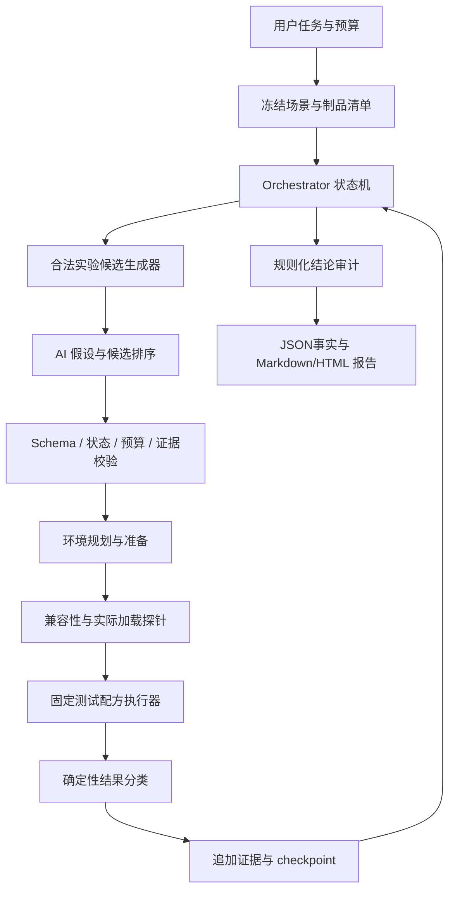

# SDK 回归定位 Agent 设计

状态：设计草案，2026-10-26。基于当前 triton-dev 接口扩展；本文的接口、CLI 和目录均为拟议契约，不表示已经实现。当前已有能力以源码和 STATUS.md 为准。本文不指定模型厂商，不要求引入 HelloAgents 运行时依赖。

## 1. 目标和结论范围

输入用户认可的 base（日期或完整 SDK 名）、latest、测试入口和目标失败判据。冻结实验场景，对照基准和最新制品，定位 SDK 回归边界，再通过组件替换实验定位关联组件或兼容组件组，最后生成能审计和重放的报告。

必须区分四种结果：

1. **观察到 SDK 更新关联**：同一场景下 base 稳定通过、latest 稳定出现同一目标失败。
2. **观察到版本边界**：一个好版本与一个坏版本之间的已测边界，声明未测版本、缺失制品及单调性假设。
3. **观察到组件干预关联**：指定上下文中换入组件引入同一目标失败，或回退组件恢复；声明替换闭包和兼容性证据。
4. **源码根因**：需要组件到仓库/commit 的可信映射及进一步代码/构建实验；前三项不能直接冒充第四项。

输出允许 incomplete、unstable、blocked、budget_exhausted；不保证每次都给出唯一库名。最终决策由程序的证据规则产生，AI 提供假设、候选排序和说明。

## 2. 当前能力与缺口

| 现有模块 | 可以复用 | 待扩展 |
| --- | --- | --- |
| env/sdk.py | SDK 选择、wheel 元数据/哈希、SDK 内容差异 | 远端历史清单和可信 digest、不可变 inventory 快照 |
| env/service.py | plan/prepare/resolve、独立 venv、变量、import probe | 通用组件映射、原生闭包、真实加载观察、隔离 SDK view |
| env wheel overrides | triton、torch_raisa、raops 的来源覆盖 | 任意库名不支持；不能把项目 torch 名称推断为其他团队包名 |
| diagnosis/predicates.py | 文本、退出码、阶段、有限一维数值判据 | 精确 pytest nodeid/覆盖检查、丰富数值结构、明确基础设施分类 |
| diagnosis/history.py | 预算内穷举、非单调/不稳定分类 | 保留旧策略，新增带假设和边界审计的二分策略 |
| execution/records.py | 真实子进程、日志、阶段、取消 | 通用实验快照与设备租约的统一适配 |
| agent/workflow.py | 登记 recipe、预算、pending、checkpoint、证据引用 | 当前 recipe 仅 good/bad，新增阶段化动态候选及 v2 协议 |
| integrations/ai | Model.respond(context) -> dict 协议 | provider 适配、模型能力协商、超时/重试/token 预算 |
| reporting | 证据包及完整性校验 | 实验矩阵、证据规则审计、重放和结构化报告 |
| pytest 服务 | 参数实例选择、xdist、日志和源码快照 | Agent 任务页与独立 agent-job API |

特别注意：当前 env.probe 的 import 路径不是 ABI/原生功能验证；当前 process_environment 也不是完整的环境隔离器。Agent runner 需要显式过滤继承变量，并观测实际依赖加载。

## 3. 架构和责任

建议一个持久化 Orchestrator 配合多种逻辑角色，首版无需同时启动多个自主 Agent。



| 逻辑角色 | 主要职责 | 不能做的事 |
| --- | --- | --- |
| Planner | 拆解问题，排列可执行候选及信息收益 | 自行发明 SDK、文件边界或可执行命令 |
| Experiment controller | 生成环境组合、执行、预算、幂等和恢复 | 将模型文本交给 shell/eval |
| Analyst | 从已授权证据摘要提出失败解释及下一实验 | 修改原始日志、通过率或失败判据 |
| Auditor | 检查结论所需证据、替代解释与缺口 | 用另一轮模型意见代替实验 |
| Reporter | 根据结构化事实说明推理过程 | 将假设写成已证明事实 |

“debug 思路明确”保存为可审计的假设、证据、决策、替代解释和下一步，不要求模型输出隐含思维链。

## 4. TaskSpec：冻结实验输入

任务入口应提供表单/CLI，落成同一份版本化 TaskSpec。以下为示意，名称与路径需由用户真实输入或登记配方解析：

```json
{
  "schema_version": 2,
  "base": {"selector": "20261020", "date_policy": "latest_build_on_date", "timezone": "Asia/Shanghai"},
  "target": {"selector": "latest", "inventory_scope": "configured_sdk_source"},
  "case": {"kind": "pytest", "recipe_id": "matmul-correctness", "nodeids": ["test_matmul.py::test_matmul[fp16-128]"]},
  "predicate_id": "matmul-error-v1",
  "execution": {"workers": 1, "seed": 42, "cache_policy": "fresh", "device_profile": "configured-device"},
  "search": {"strategy": "bisect_then_audit", "require_global_first_bad": false},
  "repetition": {"initial": 3, "maximum": 7},
  "budget": {"max_experiments": 60, "max_wall_seconds": 7200, "max_model_calls": 30, "max_model_tokens": 60000},
  "model_profile_id": "configured-model-profile"
}
```

约束：

- latest 在任务开始时只解析一次，保存完整 SDK ID、来源、时间戳、归档/文件哈希。不能每轮重新跟随 latest。
- 日期有多个构建时，按明确 date_policy 选择并在启动摘要中显示解析结果；缺失或顺序含糊时返回 needs_input。base 不在 target 之前时拒绝搜索。
- 历史列表固定为同一发行轨道、平台和构建序列，保存缺失/不可获取项。不能只按文件名字符串排序。
- case 源码/辅助文件、输入文件、nodeids、参数、容差、seed、参考结果、运行器版本均有哈希或版本。shell 只使用用户授权、已登记的脚本，不由模型生成脚本。
- pytest 为每个指定 nodeid 保留结果。多个 case 可以有不同回归边界，应拆成子调查；集合判据使用显式 any/all 规则，不能中途改变。
- Python 脚本绑定选定解释器。shell 脚本的 python、子进程和工具路径也要验证；若硬编码跳到系统环境，标记场景不受控。
- 固定驱动、硬件、固件、模型输入及外部资源 profile；不能假定切换 SDK 会切换宿主驱动。
- 预算中的一次实验指一次真实执行，包括重复、探针及重试；环境准备时间和模型等待也计入总耗时。模型费用预算只有配置可信价格表时才可用，默认控制 calls/tokens。

## 5. 状态机与实验阶段

```text
created -> frozen -> preflight -> calibrate_endpoints
        -> search_versions -> audit_boundary -> diff_components
        -> plan_interventions -> execute_interventions -> audit_attribution
        -> reproduce_bundle -> report_ready
```

任意阶段都可进入 needs_input、unsupported、cancelled、budget_exhausted 或 incomplete。所有停止状态必须生成当前报告和已取得证据，区分没有发现回归与没有足够证据。

### 5.1 校准 base 与 latest

1. 准备两套不可变环境，验证内容哈希及实际解释器/依赖路径。
2. 同一场景下重复 base/latest。建议初始各3次，交错或分块随机执行以减少时间漂移；保留确切顺序和种子。
3. base 不稳定通过：停止归因，报告 baseline_invalid 或 unstable。
4. latest 没有出现目标失败：报告 not_reproduced；不能随意换判据追逐其他报错。
5. 数值错误、段错误、超时和安装失败分别分类。故障签名可以由 AI 提议，但在实验前冻结并经用户/已登记规则确认；变更判据创建新分支并重新校准。

首版“稳定”只表示配置的重复批次内结果一致，不等于统计证明。初始重复出现分歧时可追加到 maximum；分歧样本不能靠多数票抹去，仍标记 unstable，并记录各分类次数。需要概率结论时另行配置统计检验和采样预算。

建议统一 Observation 分类：passed、target_failure、different_failure、unavailable、invalid_environment、insufficient_evidence。重复汇总可为 unstable。pytest 的 skip/xfail/xpass/零收集及缺失 nodeid 需要显式 coverage 状态，不能因退出码0被视为目标 case 通过。

### 5.2 版本二分与边界审计

默认运行 bisect_then_audit：程序选中点，AI 仅解释异常和建议额外实验。

- 搜索前提是端点稳定、场景一致；记录“假设这一段目标失败近似单调”。有限次抽查不能证明全历史单调。
- 中点稳定通过：收缩好侧；稳定出现同一目标失败：收缩坏侧。
- 中点是不同故障、不可安装或缺失：作为 unknown，不能当 good/bad。保留未决区间，尝试邻近可测点；耗尽预算仍存在间隙则报告区间。
- 观测到好坏交错、重复波动：停止普通二分推断，切到有限窗口扫描/已有穷举服务，必要时调查多个失败区间。
- 最终对 last_good/first_observed_bad 的邻接边界重复确认，设备恢复和 fresh cache 后重放一次独立确认批次。
- 二分只证明发现的局部边界；要声称“从用户 base 到 target 的全局首次坏版本”，必须排查该区间所有更早候选或具备其他独立证据。用户可通过 require_global_first_bad 请求补扫，预算不足就保留限定结论。
- 边界跨缺失构建时，不得将首个可测坏版本写成精确引入版本。也不能据构建日期直接定位某个仓库 commit。

稳定且单调假设下的二分探测约 O(log N)；重复、不可测点、边界审计和全局首次证明成本另计。

### 5.3 组件差异和优先级

生成三组差异：用户 base ↔ target、边界 last_good ↔ bad、实际混合环境 ↔ 预期 plan。

差异依据内容哈希、wheel metadata、ELF build-id/依赖及可信制品 manifest；版本号相同但哈希不同也算变化。未改变的组件不是唯一候选，但优先检查改变组件及其依赖边。

原始 base 距坏版本可能很远。因此组件归因主实验使用边界 last_good 和 bad，减少同时变化的因素；用户要求的 base + bad组件也执行，但单独标注其上下文，不把两个好环境当成同一个证据。

### 5.4 双向组件干预

设 G 为边界好版本，B 为坏版本，C 为一个合法替换单元：

| 配方 | 目的 | 与原故障有关的结果 |
| --- | --- | --- |
| G | 同批好控制组 | 通过 |
| B | 同批坏控制组 | 目标失败 |
| G + C(B) | 向前引入 | 是否出现同一目标失败 |
| B + C(G) | 反向回退 | 是否恢复通过 |
| user_base + C(B) | 用户基线场景验证 | 是否能在用户原始环境引入 |

每个干预需 fresh workspace/cache、实际加载确认、重复次数及同批控制组。替换后 import/ABI/符号失败标为 invalid_environment；若不是原目标签名，不能算 target_failure。

结论规则：

- 向前复现、反向恢复、兼容与加载验证通过：该替换单元在所测上下文中有双向干预支持，标记 component_intervention_supported。仍不自动判定组件内部代码错误或团队责任。
- 只满足一个方向：forward_association 或 rollback_association，保留另一方向失败原因和替代解释。
- 两方向都不满足：不能排除交互、适配行为、原生未覆盖或目标失败不稳定。
- 多个候选单换不复现：可在预算内做兼容组/组件子集实验；先验证整个 changed-set 迁移能否还原 B，再缩小集合。只改变合法闭包，不能随意二分文件。
- ddmin 类缩减只在可执行、稳定判据下给出所测分组的1-minimal集合；不保证全局最小、唯一根因。非单调和不可测组合必须显式保留。
- 若必须连带更换 C 的库闭包，报告“C 闭包/组件组关联”，不得写“唯一某个 .so”。

## 6. ComponentMap：环境拼凑的关键前提

现有 wheel 覆盖接口先行复用；原生组件混合需要新增受信任 ComponentMap 与 SDK view builder，不能只改变 LD_LIBRARY_PATH 顺序。

每个组件描述至少含：

| 字段 | 用途 |
| --- | --- |
| component_id / mapping_version | 真实组件边界及映射版本 |
| artifacts / ownership | wheel、so、工具、配置、数据与符号链接的确切归属 |
| requires / abi_group / conflicts | 必须共同替换的闭包与不允许组合 |
| exported_paths / entrypoints | 受控加载路径和可执行入口 |
| preflight_probes / functional_probe | 安装/链接/最小功能探针 |
| load_observer | Python module 路径、目标进程实际已加载 so/构建ID/哈希 |
| provenance | 制品到仓库/commit 的可信映射，未知时明确 unknown |

新环境按 plan 创建私有 SDK view；复制或采用只读内容存储，不修改原 SDK。不要对会写入的文件使用共享硬链接。链接不能逃逸允许的不可变制品根；文件冲突不能静默“后者覆盖前者”。

wheel 安装必须固定完整解析闭包、禁止联网取其他版本，并核对最终安装 receipt；pip 为满足依赖连带换了其他包时，不再是单组件实验。原生库需要在实际测试进程采集加载信息，包括延迟加载和子进程；独立 import probe 不能替代这些观察。无法覆盖的加载范围写入限制。

## 7. 工具接口：复用服务，不让模型拼 CLI

下表是拟议 Agent 工具协议。adapter 绑定既有 Python service；CLI/HTTP/skill 只作为入口，使用同一个业务实现。

| action_id | 关键输入 | 输出 |
| --- | --- | --- |
| sdk.inventory.freeze | 已登记源、base/target选择器 | inventory_id、解析结果、缺失项 |
| sdk.diff | 两个固定制品ID | diff_id、组件变化和未知项 |
| env.plan | sdk_id、合法组件替换 | plan_id、闭包、兼容状态 |
| env.prepare | 受信任 plan_id | environment_id、receipt/hash |
| env.verify | environment_id、profile_id | 检查结果、加载观察能力 |
| experiment.run | candidate_id、repeat_index | run_id、环境与场景引用 |
| experiment.classify | run_id、predicate_id | observation_id、分类和覆盖 |
| evidence.read | evidence_id、范围/字节上限 | 带偏移/摘要哈希的摘录 |
| report.materialize | task_id、结论审计结果 | JSON/MD/HTML/重放包 |

模型看到的是当前阶段合法 candidate_id 和受限 evidence_id。环境准备和执行由 controller 根据 candidate 编译，不接受模型的自由路径、argv、环境变量或 shell 字符串。用户自带 shell case 是启动时登记的配方，与模型生成 shell 分开。

## 8. AI API 和固定输出协议

### 8.1 Provider 配置

用受信任 ModelProfile 定义 provider、base_url、api_flavor、明确 model_id、key_ref、request_timeout、max_output_tokens、重试上限及数据外发策略。key_ref 引用进程凭据/secret store，不进入 TaskSpec、日志、模型上下文或报告。不要在命令行参数里传密钥。

OpenAI-compatible endpoint 并不保证所有功能相同：结构化输出、工具调用、usage、取消和模型版本都要能力协商。支持 schema 的 provider 使用其原生严格结构；不支持时只接受完整 JSON 对象并由本地校验，失败就有限重试，不能改用正则“捞出一个动作”执行。模型名必须显式配置，不静默 fallback 到其他模型/endpoint。

本轮为协议设计，不连接模型。实施 live provider 前再确认厂商/内网地址、模型和凭据使用方式。

### 8.2 AgentDecision v2

一次只提出一个动作，以下是示意，不代表真实 SDK 证据：

```json
{
  "schema_version": 2,
  "task_id": "task-demo",
  "turn_id": 8,
  "state_revision": 17,
  "type": "propose_experiment",
  "candidate_id": "candidate-forward-component-03",
  "hypothesis_id": "hypothesis-02",
  "reason_summary": "该组件在版本边界改变，向前替换能区分其独立影响。",
  "evidence_ids": ["evidence-sdk-diff-01", "observation-good-03", "observation-bad-03"],
  "expected_information": "判断目标故障是否随该组件引入"
}
```

正式 schema 使用 discriminated union / oneOf，additionalProperties=false，并限制字符串/数组长度：

| type | 专属字段 | 程序校验 |
| --- | --- | --- |
| propose_experiment | candidate_id、hypothesis_id、reason_summary、expected_information | 候选属于当前task/revision、阶段允许、组合合法、预算充足 |
| request_evidence | evidence_id、start、max_bytes、reason_summary | 证据归属、范围与脱敏策略 |
| propose_conclusion | conclusion_code、scope、evidence_ids、limitations | 对应结论规则的完整实验矩阵，不能由模型自行越级 |
| ask_user | question_code、question、missing_fields | 问题确实阻塞，不能把已授权步骤反复交回用户 |

公共字段均含 schema_version、task_id、turn_id、state_revision；需要证据的动作必须引用当前任务已经持久化的证据。仅“存在这个ID”不够，还要检查引用的实验、环境、场景、判据及上下文与结论匹配。

每个响应都检查 JSON语法、精确类型（bool不冒充整数）、枚举、字段互斥和预算。不执行 schema 外内容；非法响应保留为 provider_protocol_error，最多修复重试一次并计入预算。多次同一无进展提案结束 no_progress。不同版本协议不隐式兼容现有 v1。

### 8.3 控制循环

```text
load_task_and_checkpoint()
reconcile_pending_runs_without_reexecuting()
while within_total_budget:
    observations = refresh_persisted_evidence()
    controller_transition_by_rules(observations)
    candidates = enumerate_legal_next_experiments()
    if deterministic_step:
        decision = choose_by_algorithm(candidates)
    else:
        decision = provider.respond(build_bounded_context(candidates, observations))
    validate_schema_state_budget_and_evidence(decision)
    reserve_idempotent_experiment_and_persist_pending()
    prepare_verify_and_run_registered_candidate()
    classify_by_frozen_predicate()
    persist_observations_and_audit_trail()
materialize_report_even_if_incomplete()
```

二分中点、哈希、统计、分类和结论门槛不需要消耗模型。AI 适合解释不同故障、排序组件、提出交互假设和压缩报告。API 暂不可用时确定性阶段可继续；需要模型的阶段按策略暂停/保守排序继续，并清楚记录降级状态。

上下文只放任务约束、阶段、候选、小型差异、实验矩阵和证据索引；长日志按 evidence.read 取片段。保留完整证据在本地，摘要不覆盖原文件。日志和源码作为数据，不能成为新指令；不赋予模型读取任意宿主文件的入口。

## 9. 复现与隔离

- SDK/组合内容寻址，已准备环境只读复用；每个真实实验独立工作目录、HOME/tmp/Triton/CUDA缓存。
- 默认 workers=1；先排除测试间并行干扰。用户选择 xdist 时把并发、调度策略及设备分配作为固定实验条件，不可中途改变。
- 设备实验需 scheduler lease、健康探测及失败恢复；崩溃后恢复失败就暂停相关设备，不继续污染后续对照。
- stage-level receipt 区分“预计加载”和“实际加载”，保存未验证项。脚本环境没有加载观测能力时结论降级。
- 实验前校验内容漂移；新版本/新脚本/新判据产生新 task/branch，而不是修改旧记录。
- 恢复时区分 queued/running/finished/interrupted，校验 pending run 已有结果，不盲目重放副作用。跨进程锁/lease 和幂等ID保证同一 task 只有一个 controller。
- 模型 API 重试与实验重试分开，预算从持久账本扣减。取消会停止 controller、模型请求（若provider支持）和整个测试进程组；不支持取消的远端请求须说明可能仍被计费。

## 10. 报告与证据包

JSON 是事实源，Markdown/HTML 由确定性模板渲染。AI 可提供解释段落，但需逐条绑定 claim_id/evidence_id；模板不允许覆盖事实表。

报告固定结构：

1. **结论与范围**：已定位什么、未证明什么、结论code、可测范围与缺失项。
2. **原始问题与冻结场景**：用户base/latest解析、case/参数/源码/输入/设备、判据及版本。
3. **SDK/组件差异**：版本和哈希、依赖闭包、实际加载路径及未知项。
4. **实验思路**：每个 hypothesis 的依据、预期区分、替代解释、下一步及停止原因。
5. **版本搜索轨迹**：每轮候选/区间、每次结果、重复次数、边界、假设和未测点。
6. **组件干预矩阵**：好/坏控制组、双向替换、用户base验证、闭包和兼容性结果。
7. **复现说明**：输入和制品获取方式、哈希校验、机器前提、固定配方及可运行重放入口。
8. **证据索引**：run、stdout/stderr、阶段、数值产物、环境receipt、代码快照、SHA256及截断情况。
9. **资源与限制**：实际运行时间、预算、provider/model标识、工具版本、恢复/降级/未验证项。

示意目录（需新增实现）：

```text
investigation/
  task.json
  inventory.json
  scene.lock.json
  component-map.lock.json
  experiments.jsonl
  decisions.jsonl
  claims.json
  environments/<id>/receipt.json
  runs/<id>/{request,result,stdout,stderr,stages,load-map,...}
  report.json
  report.md
  report.html
  replay.json
  SHA256SUMS
```

重放以 replay.json 指向冻结 recipe/env/input/判据，不依赖重新调用AI。模型决策不可保证再次生成一致，但已执行实验必须可以按账本重放。软件与输入可重建不代表硬件偶现故障必然复现；报告记录成功/失败次数及不可恢复的外部条件。

完整内部证据和可分享包分开：敏感日志默认不外发，上传模型前应用配置的摘要/脱敏策略；每次模型请求保留实际发送内容的受控审计记录。脱敏后重算分享包manifest，不伪装原始哈希相同。制品若不能随包分发，提供可信来源与哈希并将重放标为 artifact_required，不能用 latest 代替。

## 11. CLI / Server / Skill 入口

拟议 CLI（尚未实现）：

```text
triton-dev agent regression start --base <date-or-sdk> --target latest --recipe <id> --model-profile <id>
triton-dev agent regression status <task_id>
triton-dev agent regression resume <task_id>
triton-dev agent regression cancel <task_id>
triton-dev agent regression report <task_id> --format html
triton-dev agent regression replay <task_id> --experiment <experiment_id>
```

拟议 HTTP：POST /api/agent/tasks、GET /api/agent/tasks/:id、POST resume/cancel、GET experiments/hypotheses/report。未来加入用户归属、artifact ACL、事件游标；不为当前 loopback API 宣称已具备多用户权限。

网页分为任务输入、版本搜索、组件矩阵、实验详情和报告；可以复用当前运行详情和 worker 日志。skill 只负责把用户意图填成 TaskSpec、调用CLI和解释报告，不承担唯一的状态记忆或环境拼凑逻辑。

## 12. 实施顺序与验收

| 阶段 | 交付 | 核心验收 |
| --- | --- | --- |
| P0 | TaskSpec/Observation/Decision schema、冻结场景、统一证据、策略接口 | ScriptedModel全流程可重放；非法JSON/伪证据/状态过期不执行 |
| P1 | 真实本地SDK清单、端点校准、二分+审计及报告 | 非单调、缺失版本、skip、不同失败、基线失效和预算停止不会误归因 |
| P2 | 现有wheel覆盖的双向组件矩阵 | 独立/交互故障、依赖连带变化、安装不兼容被正确区分 |
| P3 | ComponentMap插件、原生SDK view、加载观察及设备lease | 单独native集成门禁；实际so来源/闭包可验证；不覆盖原SDK |
| P4 | 指定provider/model的live适配、受限AI评测 | 超时/限流/截断/注入/重复提案可停止；API日志无凭据 |
| P5 | 服务器agent-job API、网页任务与报告交互 | 取消/重启恢复、归属和限额、证据下载、复测新记录 |

P0-P2可先用合成SDK与真实子进程验证，mock只声明流程证据；真实LLVM/cmodel归因要等P3接口和真实设备验证。可先并行设计provider协议，但不以API接入替代基础证据工程。

建议离线评测集覆盖：稳定回归、无回归、坏基线、非单调历史、同版本不同哈希、缺制品、偶现、组件单独引入、只回退有效、组件交互、ABI不兼容、源码漂移、缓存污染、错误python路径、伪证据、越权工具、恢复中断、日志截断和资源耗尽。

指标包括：已知答案任务定位准确率、无依据归因率、遗漏限制率、非法工具拦截率、实际实验次数、重放一致率和模型调用成本。AI还需对比纯确定性策略，只有在减少实验或改善解释且不增加误归因时才算收益。

## 13. Hello-Agents 参考与取舍

参考资料读取日期：2026-10-26；链接跟随上游main，实施时应锁定参考提交。

- [第四章：智能体经典范式](https://github.com/datawhalechina/hello-agents/tree/main/docs/chapter4)：采用先规划、按观察调整、阶段审计的组合；本项目的可执行权限和结论门槛交给确定性控制器。
- [第九章：上下文工程](https://github.com/datawhalechina/hello-agents/tree/main/docs/chapter9)：借鉴有限上下文和按需证据检索，避免每轮发送全量日志。
- [第十二章：智能体性能评估](https://github.com/datawhalechina/hello-agents/tree/main/docs/chapter12)：将评测作为独立验收项，使用本项目的故障样本与证据/重放指标。

以上是结合本项目约束作出的设计，不是声称Hello-Agents已经提供SDK二分或原生组件归因实现。不直接复制教程的通用终端工具执行模型命令，首版不强制引入其框架。

## 14. 当前实施入口

针对baseline + pytest命令的首版产品契约见[REGRESSION_V1.md](REGRESSION_V1.md)，细化先基线验证再update、严格最近回归补扫、目录/CLI/模型配置与验收分期。本文保留通用架构和证据要求。
