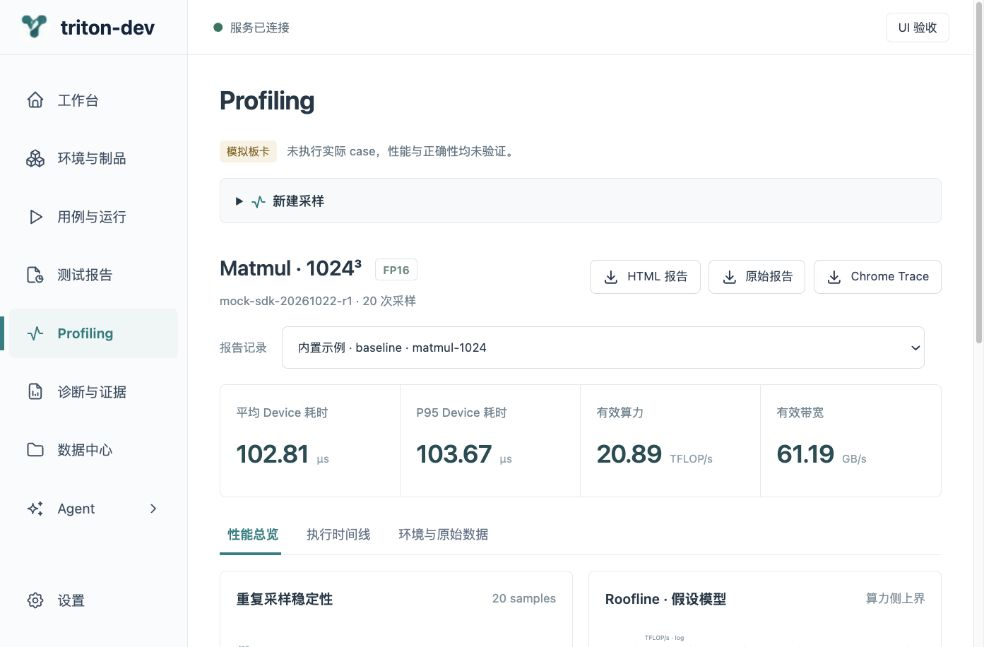
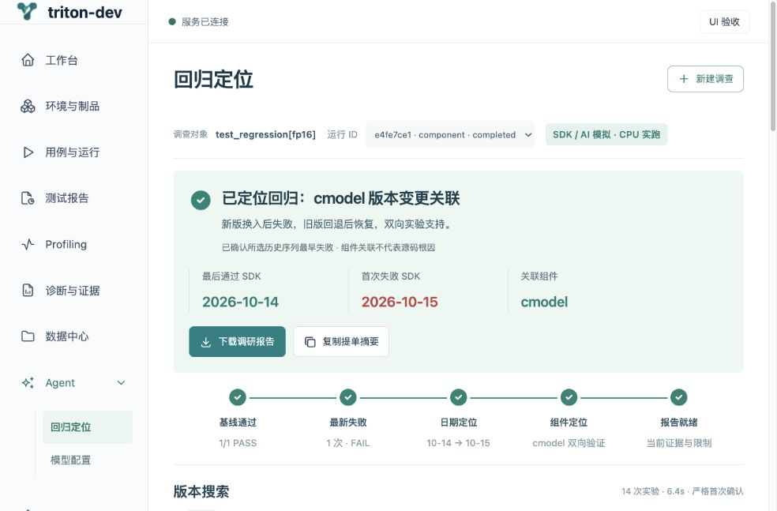
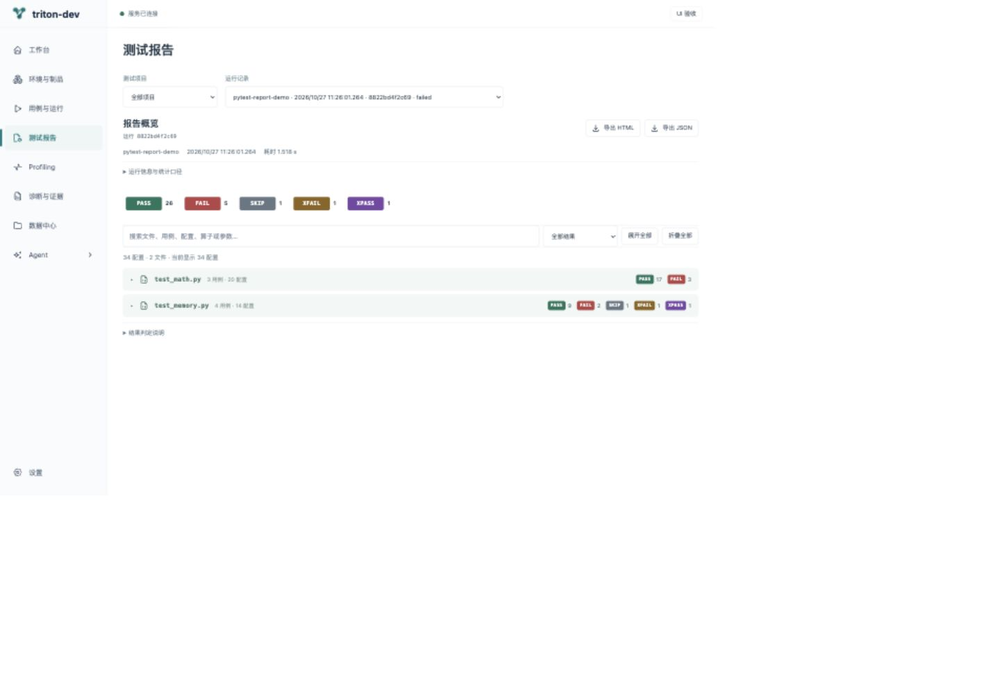

# UI 精简验收记录

2026-10-27。当前浅色青绿界面为设计依据，检查后在原项目内收敛样式与信息结构。未重做业务工作流、数据库或模型适配器。

## 检查依据与问题

本轮检查了工作台、环境、用例与运行、报告、Profiling、回归、诊断、数据、模型和账号页面。调整前截图保存在 `frontend/design/refine/before-*.png`。

主要问题：顶栏姓名和模式重复；标题下介绍性文字过多；Profiling 配置表单占据结果首屏；报告元数据和口径常驻；收集空态重复操作；账号低频数据占用大卡片；回归通过后仍展示等待搜索、空组件对照和无效复现入口。

前后截图中的记录和用户空间可能不同，只比较布局、层级与交互，不把数字变化当作性能改善。

## 逐模块检查

| 步骤 | 页面 / 流程 | 验收结果 |
|---|---|---|
| 1 | 导航、连接状态、账号入口 | 通过：删除重复姓名、日期、模式胶囊和固定页脚；保留连接状态和当前用户 |
| 2 | 工作台、环境与制品 | 通过：移除口号式介绍，保留快速入口、紧凑版本表格、演示来源和抽屉入口 |
| 3 | 用例收集、参数选择与并行运行 | 通过：真实 CPU 示例收集 34 配置；选择 Workers=4 后实际运行，结果为 26通过 / 5失败 / 1跳过 / 1预期失败 / 1意外通过 |
| 4 | 运行总览与阶段明细 | 通过：统计数字、图表和阶段证据保留；口径折叠；使用真实 gw0–gw3 结果；仅复测失败、全量复测与日志入口保留 |
| 5 | 测试报告 | 通过：2 文件 / 7 用例 / 34 配置，文件默认折叠，可展开到参数配置；保留 PASS/FAIL/SKIP/XFAIL/XPASS 色块与 HTML/JSON 导出 |
| 6 | Profiling 总览与时间线 | 通过：默认表单收起，报告及四项指标优先；11 条轨道，固定引擎列仍为 sticky；390px 下选择 4×，聚焦后 W 键变为 8× |
| 7 | 回归：组件失败路径 | 通过：真实 CPU + mock SDK/模型完成 14 实验，显示 10-14 → 10-15、cmodel 双向关联；原始实验、模型决策与复现保留 |
| 8 | 回归：最新通过路径 | 通过：仅 2 张已验证版本卡，日期 / 组件步骤显示“无需执行”；无空对照矩阵与无效复现面板；不把这些步骤标成已完成实验 |
| 9 | 诊断与证据、数据中心 | 通过：精简重复提示；保留目标判据、版本选择；任务类型 / 结果下拉与查询、日期和结果展示正常 |
| 10 | 个人模型配置 | 通过：新增 UI Mock 配置可保存；模型、Provider、Key状态、启用状态与操作紧凑呈现，revision按需展开；未使用真实Key或外部API |
| 11 | 账号与响应式 | 通过：账号用量改为清单；390px 实测报告根宽379px≤视口390px，无整页横向溢出；文件默认折叠；表格与时间线局部滚动 |

通过不代表完成完整无障碍认证：本轮确认语义控件、可见焦点规则、原生折叠、时间线键盘操作及窄屏显示；屏幕阅读器、全部键盘路径、跨浏览器和高对比度模式未做全面验收。模拟板卡结果仍不可用于设备验收。

## 验证方式

- 生产构建与前端模型 / 会话测试，以及 Sites 静态资源测试。
- 本轮追加“最新通过时跳过不必要搜索”的视图测试，并保留未完成重复实验不会冒充成功的检查。
- 浏览器使用独立 localhost 验收服务与 UI 验收空间；不向当前用户的正式工作区添加测试记录。当前服务本身仍是 PostgreSQL 多用户模式。
- 补充 hash 路由同步，使直接切换模块 hash 时同步页面，不必依赖重新载入。
- 未修改后端执行、权限、计数规则、数据库迁移或真实SDK环境。

## 代表性截图

### 性能报告：结果优先

### 回归：结论与证据层级

### 测试报告：默认折叠

窄屏截图：`frontend/design/refine/after-reports-mobile.png`、`after-timeline-mobile.png`。其余模块截图以 `after-模块名.png` 保存。

最终检查：20 项模型/会话测试、4 项静态打包测试与生产构建通过；浏览器 console error 为空。独立 QA 标签页和验收服务在完成后关闭，当前用户原工作页保留。
